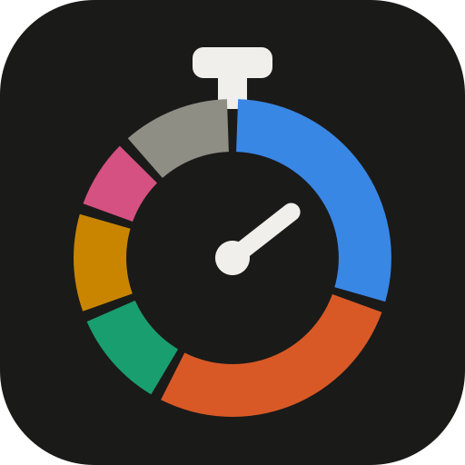
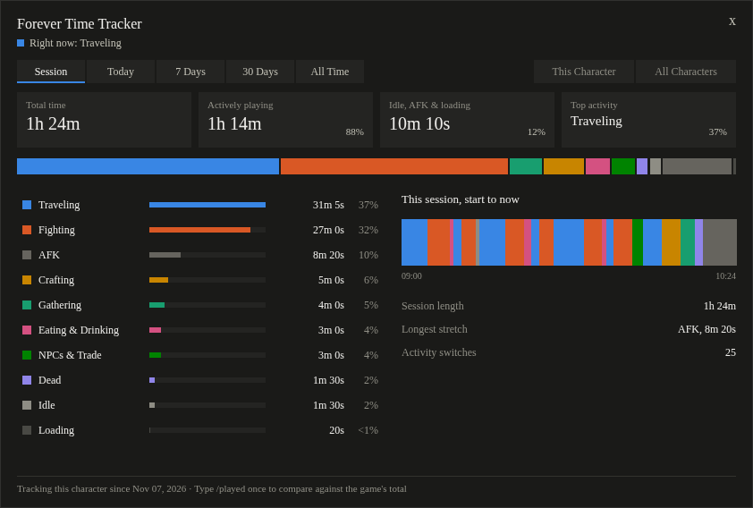
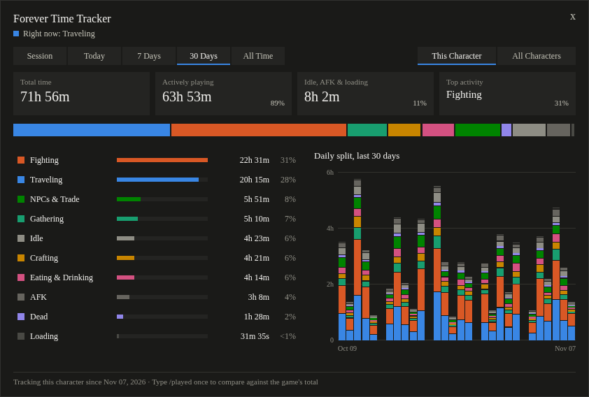

# Forever Time Tracker

**`/played` tells you how long. This tells you what you actually did with it.**

Forever Time Tracker sorts every second you spend in World of Warcraft: Forever into categories like Fighting, Traveling, Crafting and AFK. Then it shows you the split. Find out how much of that 8-hour session was combat, and how much was running back from the graveyard.





*Previews made with sample data. The font differs slightly in-game.*

## What you get

- **A full breakdown.** Time and percentage for each activity, sorted from most to least.
- **A timeline of your session.** See when you were fighting and when you stood in Orgrimmar for twenty minutes.
- **Daily history.** Stacked columns for the last 7 or 30 days. Hover over a day for its numbers.
- **Actively playing vs. not.** One number for real play, one for idle, AFK and loading screens.
- **Every character.** Switch between one character and all of them, for any time range.
- **Nothing to set up.** Install it and play. It starts counting when you log in.

## What it tracks

| Category | When it counts |
| --- | --- |
| Fighting | The game has you in combat |
| Traveling | You're moving, mounted or not, or on a flight path |
| Gathering | Mining, herbing, skinning or fishing |
| Crafting | Crafting something, or standing at an open profession window |
| Eating & Drinking | Sitting with food or drink |
| NPCs & Trade | Quest dialogs, vendors, trainers, mail, the bank, the auction house and trades |
| Dead | Lying dead or running back as a ghost |
| Idle | In the game but not doing anything: chatting, reading the map, deciding what's next |
| AFK | Flagged AFK, plus the idle minutes before the game set the flag |
| Loading | Loading screens |

Each second counts once, so the categories always add up to your total.

## Install

1. [Download this project as a ZIP](https://github.com/maddeye/forever-time-tracker/archive/refs/heads/main.zip) and unpack it.
2. Copy the `ForeverTimeTracker` folder from inside it to your Forever AddOns folder:
   ```
   World of Warcraft/_forever_/Interface/AddOns/
   ```
3. Restart the game if it's running, and check that the addon is enabled in the AddOns list on the character screen.

Can't find the folder? In Battle.net, click the gear icon next to Play and choose "Show in Explorer".

## How to use it

Click the stopwatch on your minimap or type `/ftt`. Drag the window to move it, and press Escape to close it.

| Command | What it does |
| --- | --- |
| `/ftt` | Opens or closes the window |
| `/ftt minimap` | Hides or shows the minimap button |
| `/ftt reset` | Deletes this character's data, after asking you to confirm |
| `/ftt debug` | Prints what the addon thinks you're doing right now |

## FAQ

**Why is the total lower than `/played`?**
The addon can only count time since you installed it. `/played` goes back to the day you made the character. Type `/played` once and the bottom of the window shows both, so you can compare.

**Why isn't there a Questing category?**
The game doesn't tell addons that you're "questing". Killing quest mobs counts as Fighting, walking to them counts as Traveling, and talking to the quest giver counts as NPCs & Trade.

**Where's my minimap button?**
UI packs often collect minimap buttons into one group. With EllesmereUI, it sits in the group button's flyout unless you turn on "Ungroup Minimap Buttons" in EllesmereUI's minimap options. `/ftt` always works.

**Did I lose time after a crash?**
Probably some. The game only saves addon data when you log out or `/reload`, so a crash loses everything since the last save.

**My eating or gathering shows up as Idle.**
Eating and drinking are recognized by buff name in English, German, French and Spanish. Gathering is matched in English and German, and other client languages may miss it. If yours is wrong, please [open an issue](https://github.com/maddeye/forever-time-tracker/issues) with your client language.

**Does it send my data anywhere?**
No. The addon has no network or addon-message code. Your data stays in your `WTF` folder.

**Does it work on Retail or Classic?**
No. It's built for Forever only.

## Found a bug?

This is an early version, so a wrong category is likely. [Open an issue](https://github.com/maddeye/forever-time-tracker/issues) with what you were doing and the output of `/ftt debug`.

Want to help build it? See [CONTRIBUTING.md](CONTRIBUTING.md).

## License

[MIT](LICENSE)
